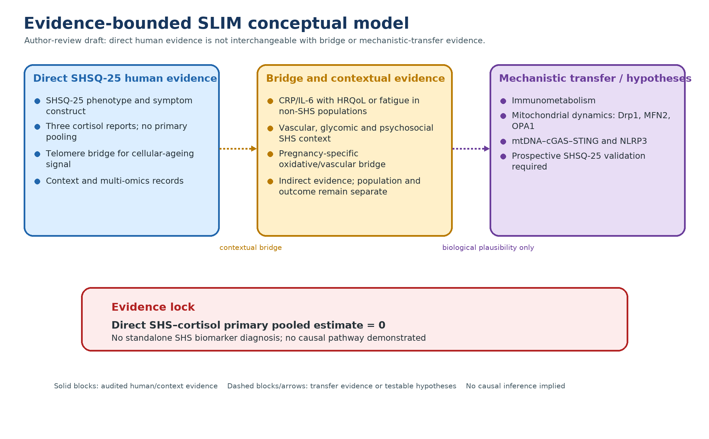

# Low-grade inflammation, stress-axis dysregulation and a proposed immune-metabolic continuum in suboptimal health defined by SHSQ-25

## Abstract

Suboptimal health status (SHS) is a symptom-defined, pre-diagnostic state commonly assessed with the Suboptimal Health Status Questionnaire-25 (SHSQ-25), but reported biological correlates use non-equivalent thresholds and assays. Sixteen supplied PDFs were audited for exact identity, source tables, cohort provenance, assay context and estimands. Three reports contained direct SHS-related cortisol contrasts, but they used sample-median or latent-class definitions, serum or plasma, raw or adjusted estimates, and potentially overlapping Beijing occupational/health-examination frames. A transparent three-report calculation was retained as exploratory only (mean difference 32.60 ng/mL, 95% confidence interval 11.64–53.56; I²=99.3%); no report met all criteria for a primary pooled direct-cortisol estimate, and the direct-cortisol certainty was very low. One locally audited telomere study, one pregnancy-specific oxidative/vascular study and four SHS context/multi-omics records were retained as separate bridge strata. Low-grade-inflammation/quality-of-life and inflammation/fatigue records were also kept separate from direct SHS evidence. A proposed SLIM framework—Suboptimal health, Low-grade inflammation and ImmunoMetabolic stress—organizes testable hypotheses but does not demonstrate a causal pathway. Current evidence does not support any standalone SHS biomarker diagnostic test, and SHSQ-25 should not be presented as a molecular diagnosis. Future studies need harmonized cortisol protocols, cohort deduplication and prospective measurement of inflammatory, mitochondrial and innate-immune endpoints in SHSQ-25-defined human populations.

## 1. Introduction

### 1.1 Suboptimal health as a measurement problem before it is a disease label

Suboptimal health status (SHS) describes perceived symptoms and functional complaints in people who do not meet criteria for a diagnosed organic disease. The SHSQ-25 was developed as a 25-item instrument covering fatigue, the cardiovascular system, the digestive tract, the immune system and mental status. The questionnaire-development study [1] established the measurement context. It is not a biomarker effect study.

The measurement construct is clinically attractive because it may capture a period in which symptoms are meaningful but potentially reversible. It is also methodologically fragile. A questionnaire score can be divided at a canonical threshold, a sample median or a population-specific validation cutoff. These choices do not necessarily define the same population. A biomarker can be an external correlate of SHS, or it can be incorporated into the algorithm used to assign the SHS class. Those two designs answer different questions and must not be pooled.

The current evidence audit therefore separates three questions:

1. Is cortisol higher or otherwise different in groups defined independently by an SHS questionnaire?

2. Does low-grade inflammation associate with fatigue or health-related quality of life in conceptually related populations that do not use SHSQ-25?

3. Can these observations support a mechanistic model involving immune-metabolic reprogramming and mitochondrial dynamics?

Only the first question is eligible for a direct SHS/cortisol synthesis. The second is bridge evidence. The third is a proposed model requiring new validation rather than a claim supported by the currently audited PDFs.

### 1.2 Why source and estimand auditing precede Meta-analysis

A pooled estimate is not made valid by the availability of means, standard deviations and a common unit. The study populations, exposure definitions, outcome definitions and data-generating processes must also be sufficiently exchangeable. The three direct cortisol reports illustrate the problem. All were conducted in Beijing occupational or health-examination settings, but their recruitment periods and employer frames are incompletely reported. Two reports use sample-median SHS groupings, and the third uses a latent-class model that includes cortisol itself. One report reports serum cortisol and an unadjusted group comparison; another reports adjusted plasma values; and the LCA report uses a diagnostic-class contrast.

These differences create two distinct risks. First, the same participants could be counted more than once if studies draw from a common employer or hospital examination frame. Second, a pooled contrast could mix a conventional association estimate with a diagnostic classification contrast. The first risk is a dependence problem. The second is an estimand problem. Neither is solved by a random-effects model.

### 1.3 A cautious SLIM hypothesis

The proposed SLIM framework links three levels without claiming that the current evidence has demonstrated the chain. At the symptom level, SHS represents a measurable burden of fatigue and multisystem complaints. At the physiological level, altered stress-axis regulation and low-grade inflammatory signaling may accompany that burden. At the cellular level, immune-metabolic reprogramming and mitochondrial dynamics could provide a candidate mechanism connecting energetic demand, redox state and innate immune activation.

Mitochondrial fission/fusion balance is positioned as an upstream hypothesis because it could, in principle, influence oxidative phosphorylation, reactive oxygen species, mitochondrial-DNA release and inflammatory sensing. The current source-audited clinical records do not measure Drp1 phosphorylation, Mfn2, OPA1, cGAS–STING, NLRP3 or Seahorse respiration in SHSQ-25-defined participants. Those components are therefore model propositions and research priorities, not current clinical findings.

### 1.4 Mechanistic transfer evidence, not direct SHS evidence

The mechanistic rationale is supported by a separate transfer-evidence set, not by the direct SHS/cortisol reports. The immunometabolism transfer review [2] describes immune-signal control of glycolysis, TCA intermediates and oxidative phosphorylation. The MFN2/OPA1 mitochondrial-dynamics review [3] supports the role of fusion proteins in bioenergetics and quality control. The Drp1-Ser637 mitophagy study [4] illustrates phosphorylation-site and context dependence.

Two additional transfer sources motivate innate-immune measurements: a microglial mtDNA/cGAS–STING review [5] and an acute-kidney-injury cGAS–STING study [6] connect mitochondrial damage or mtDNA leakage to cGAS–STING in non-SHS systems. An apoptosis/oxidized-mtDNA study [7] provides experimental support for an mtDNA–NLRP3 link. These studies establish biological plausibility, not a demonstrated SHS pathway. The transfer evidence remains biologically plausible rather than direct SHS evidence.

## 2. Methods: source-audited evidence adjudication

### 2.1 Evidence sources

The source-verification phase began with supplied article PDFs and was extended by additional SHS context/multi-omics and telomere records. Available sources were checked for exact article identity, source location and quantitative extraction. This was not a new four-database systematic search or a dual-screening process.

### 2.2 Eligibility for the locked direct-cortisol synthesis

A report could contribute to a primary quantitative direct-cortisol synthesis only if all of the following were satisfied:

- the exact article identity and source table were verified;

- SHS classification was defined independently of the cortisol outcome;

- the population could be reasonably distinguished from other reports;

- cortisol matrix, sampling time and assay were sufficiently comparable;

- the reported or derivable effect represented a compatible estimand; and

- the effect and uncertainty were traceable to the source.

A report could remain in narrative synthesis even if it failed the pooling gate. Bridge evidence was never eligible for pooling with direct SHS/cortisol data.

### 2.3 Derivation of study-level values

For descriptive transparency, mean differences were calculated as the reported SHS or LCA group mean minus the reference mean. When only group means and standard deviations were available, the independent-group approximation was used to derive a confidence interval. These CIs are labelled derived, not author-reported. Derived calculations do not correct for cohort dependence, adjustment differences or diagnostic incorporation.

### 2.4 Cohort reconciliation

The reconciliation recorded recruitment period, employer or sampling frame, hospital/health-centre source, author overlap, sample flow, age range, SHS definition, cortisol matrix, fasting/sampling time and assay. “High concern” indicates that independence or estimand compatibility could not be demonstrated; it does not prove duplicate participants.

### 2.5 Targeted candidate verification and search boundary

The targeted candidate pass used targeted PubMed/PubMed Central record review, DOI-page matching and the supplied PDFs. It was not a new comprehensive multi-database search and did not include independent dual screening. A record entered the active evidence map only when its exact article identity and DOI matched the same source and its population/outcome role was compatible with the narrative question. Pregnancy-specific, intervention, psychosocial, context/multi-omics, mechanistic-transfer and cohort-provenance records were retained in separate strata. Reviews/book chapters, TCM/BDT interventions, MetS-only analyses and unresolved identity tuples were not promoted to direct SHS molecular evidence. Non-detection of CRP/IL-6, strict HRV or specific mitochondrial/innate-immune endpoints is therefore reported only within this targeted search scope and is not an absolute absence claim.

## 3. Results

### 3.1 Direct source-audited cortisol evidence

The source-verified study roles are provided below. All three reports are retained for narrative transparency, but none is assigned to the primary pooled estimate.

**Table 1. Source-audited direct SHS–cortisol reports and pooling disposition.** Values labelled derived are calculated from source-reported group summaries; the table does not constitute a primary pooled estimate.

| Report | Source-located data | Derived study-level contrast | Locked interpretation |
|---|---|---|---|
| Yan et al. 2012 [8] | Serum cortisol: high sample-median SHS score ≥44, n=1,547, 204.31 ± 40.06 ng/mL; low score <44, n=1,472, 161.33 ± 27.83 ng/mL; PDF p.6 Table 2 | MD 42.98 ng/mL; derived 95% CI 40.53–45.43 | Potentially etiologic, but recruitment period and employer overlap are unresolved; raw serum estimate not pooled |
| Yan et al. 2015 [9] | Plasma cortisol: high sample-median SHS score ≥35, n=193, 178.58 ± 18.25 ng/mL; low score <35, n=189, 167.77 ± 12.25 ng/mL; mRNA GRα 86.79 ± 44.79 vs 100.52 ± 58.71 (p=0.027), GRβ/GRα 0.93 ± 0.64 vs 0.78 ± 0.47 (p=0.021); PDF p.6 Table 4; adjusted for sex, age, company and waking-to-sampling interval | MD 10.81 ng/mL; derived 95% CI 7.70–13.92 | Direct SHSQ-25 stress-axis/receptor evidence, but the January–April 2012 Xuanwu Hospital frame may overlap Yan 2012 and cortisol values are adjusted; GR findings are not pooled |
| Yan et al. 2018 [10] | Plasma cortisol: LCA-defined SHS, n=298, 205.80 ± 29.82 ng/mL; LCA-defined health, n=570, 161.80 ± 7.79 ng/mL; PDF p.4 Table 2 | MD 44.00 ng/mL; derived 95% CI 40.55–47.45 | Diagnostic evidence only: cortisol is a manifest variable in the class assignment and cannot be treated as an independent outcome |

The supplied Yan 2015 Table 1 additionally confirms the high/low SHS group structure (n=193/189) and reports psychosocial-stress comparisons adjusted for sex, age and company. The Table 4 GRα decrease and GRβ/GRα increase provide a direct receptor-level companion to the cortisol contrast, but they come from the same cross-sectional sample and do not establish mediation or causality. This is contextual evidence from the same cross-sectional sample, not an additional cortisol estimand; it does not identify employers or resolve cohort overlap.

The 2012 study recruited workers through an examination frame involving 21 companies but did not name those companies or report the recruitment period. The 2015 study recruited 386 workers from three named Beijing employers during January–April 2012 and analyzed 382 after excluding four cortisol outliers. The 2018 study analyzed 868 employees from companies in Xuanwu district, but did not report its recruitment period or employer list. All three reports used the Xuanwu Hospital/Capital Medical University system, and the research teams overlap. The sources do not provide participant identifiers or a deduplication statement.

### 3.2 Why the direct reports were not pooled

The SHS definitions are not equivalent. The 2012 and 2015 reports use sample-median cut points, while the 2018 report uses a latent-class procedure after initial SHSQ-25 and biomarker classifications. The cortisol measurements are also not identical: the 2012 report describes serum cortisol after overnight fasting with clock time not reported; the 2015 report describes plasma collected between 7:30 and 8:30 a.m. and adjusts for waking-to-sampling interval; and the 2018 report describes a 10-hour fast, morning sampling after acclimatization and a commercial radioimmunoassay.

The analytic estimands differ as well. The 2012 Table 2 comparison is a raw group contrast. The 2015 Table 4 values are covariate-adjusted. In the 2018 study, cortisol contributes to the definition of the classes whose cortisol distributions are then compared. A pooled estimate would therefore combine potentially dependent populations and non-equivalent estimands.

For transparency, the three report-level values were entered into a DerSimonian–Laird calculation using derived independent-group variances. The exploratory result was MD 32.60 ng/mL (95% CI 11.64–53.56), Q=297.33, I²=99.3% and τ²=340.84. Leave-one-out results were unstable. This calculation is not a primary review result.

### 3.3 Low-grade-inflammation and fatigue/quality-of-life bridge evidence

The bridge evidence addresses related but different outcomes and populations.

The Swedish CRP/IL-6 quality-of-life study [11] reports adjusted SF-36 contrasts relative to a high-CRP/high-IL-6 group. The vitality contrasts are source-located bridge estimates, not raw SHS group means and not a direct SHSQ-25 result.

The Danish Blood Donor Study quality-of-life report [12] reports stratified regression coefficients for SF-12 physical health-related quality of life. It does not verify the historical fatigue OR or SF-36 vitality row previously associated with the label “Danish DBDS 2019.”

The Whitehall II fatigue cohort study [13] reports separate fully adjusted fatigue ORs for CRP and IL-6. It does not verify the historical joint-marker OR 1.60. These three sources are retained as a separate narrative bridge and not pooled with direct SHS/cortisol evidence.

### 3.4 Evidence certainty and quarantined rows

The direct-cortisol evidence was graded Very low because of serious/unclear risk of non-independence, very serious inconsistency, non-equivalent SHS definitions, diagnostic incorporation in one report and derived rather than author-reported CIs. Bridge evidence was graded Low for the specific reported bridge outcomes, but it remains indirect for SHSQ-25-defined SHS.

Historical rows without verified exact article identity, or whose verified source did not support the entered outcome or effect, were quarantined. No historical NLR, HRV, OXPHOS or fatigue pooled estimate is reported in this manuscript version.

### 3.5 Verified context and multi-omic roadmap evidence

Four additional SHS context and multi-omics records broadened the phenotype-to-mechanism roadmap without changing the primary synthesis. The SHS–endothelial function study [14] reports a community-based SHSQ-25/endothelial-function bridge in 459 Russian residents. the SHS glycomic study [15] reports plasma IgG N-glycan profiling in 124 SHS participants and 124 matched controls, offering a multi-omic biomarker layer rather than a cortisol or mitochondrial endpoint. The SHS symptom-network study [16] uses network analysis to describe SHSQ-25 symptom architecture in 217 Ghanaian participants. The unpaid-carer SHS study [17] provides a psychosocial risk-stratification context in 203 unpaid carers and 165 controls. These studies support future composite phenotyping but are not pooled with direct cortisol or mechanistic transfer evidence.

### 3.6 Verified SHSQ-25 molecular and oxidative bridge evidence

Two additional human records strengthen the molecular bridge while remaining outside the primary cortisol synthesis. The SHS–telomere study [18] was source-verified. It compared 294 SHS cases with 294 matched ideal-health controls using SHSQ-25 and quantitative-PCR relative telomere length; SHS was defined by an SHSQ-25 score ≥35. The source reports lower median RTL in SHS than ideal health (0.86 [0.71–1.00] vs 0.98 [0.82–1.13], p<0.001) and a negative SHS-score/telomere correlation (r = −0.218, p<0.05). In the fully adjusted model, the first, second and third RTL quartiles versus the longest quartile had ORs of 3.81 (95% CI 2.21–6.56), 2.84 (1.65–4.90) and 1.71 (1.00–2.94), respectively in its adjusted telomere-quartile analysis. The paper describes this as a retrospective case–control analysis nested in the prospective COACS baseline survey and acknowledges temporal ambiguity, absent genetic contribution data and limited generalizability beyond the Chinese population. This is a cellular-ageing/replicative-stress bridge, not a direct measure of mitochondrial dynamics or innate immune activation.

A second pregnancy-specific SHS oxidative/vascular study [19] originates from 593 normotensive singleton pregnancies assessed with SHSQ-25 at 10–20 weeks. It reports pregnancy-specific associations involving oxidative DNA damage, angiogenic mediators and placental pathology among women who later developed preeclampsia. This evidence is retained as a pregnancy-specific oxidative/vascular bridge and is not generalized to non-pregnant SHS or interpreted as mitochondrial-dynamics mediation.

Together, these records permit a more precise translational bridge—SHS phenotype, stress-axis/receptor alterations, cellular-ageing markers and oxidative/vascular signals—while the human evidence still does not directly measure Drp1, MFN2, OPA1, PINK1/Parkin, mtDNA release, cGAS–STING or NLRP3 in SHSQ-25-defined participants.

### 3.7 Evidence hierarchy and permissible inference

The 19 verified anchors are article-level records, not 19 interchangeable biomarker studies. Their roles and permissible inferences are therefore kept separate:

**Table 2. Evidence strata and permissible inference boundaries.** Counts refer to verified article-level records, not independent cohorts or interchangeable biomarker studies.

| Evidence stratum | Article-level records | Evidence basis | Permissible inference | Not permissible |
|---|---|---|---|---|
| SHSQ-25 measurement context | 1 | Article identity verified; source role recorded in the reference register | Defines the questionnaire construct and cutoff context | Biomarker effect or mechanistic conclusion |
| Direct SHS–cortisol | 3 | Supplied PDFs locally audited; locked synthesis map | Study-level cortisol observations | Primary pooled cortisol estimate; causal HPA claim |
| Direct SHSQ-25 molecular bridge | 1 | Source-audited human molecular bridge; article identity and source table verified | Association of SHS with relative telomere length/cellular-ageing signal | Mitochondrial-dynamics mediation or cortisol pooling |
| Pregnancy-specific oxidative/vascular bridge | 1 | PubMed/PMC identity and full text verified online | Pregnancy-specific oxidative, placental and angiogenic context | Generalization to non-pregnant adults |
| SHS context/multi-omics | 4 | Source-audited records | Vascular, glycomic, symptom-network and psychosocial context | Temporal/causal network inference or mitochondrial mechanism |
| Non-SHS low-grade-inflammation bridges | 3 | Article identities and outcome-specific source records verified | Separate HRQoL/fatigue bridge narrative | Treating CRP/IL-6 results as direct SHSQ-25 evidence |
| Mechanistic-transfer evidence | 6 | Exact identities verified; mechanistic-transfer evidence considered separately | Biological plausibility and testable hypotheses | Claim that the pathway is demonstrated in SHS |
| Total | 19 | 19 verified anchors | Layered narrative synthesis | No primary pooled direct-cortisol result |

This hierarchy is the central safeguard against evidence inflation: adding a verified context or transfer record increases explanatory coverage, but it does not change the direct-cortisol pooling decision.

## 4. Discussion

### 4.1 What the evidence supports

The current audit supports a cautious statement that three Beijing occupational or health-examination reports observed different cortisol distributions across groups labelled as SHS or latent-class SHS. The direction of the group contrast is consistent across the three reports, but direction alone does not establish a common effect size, independent replication or causality. The locally audited telomere study adds a cellular-ageing bridge, while the pregnancy-specific oxidative/vascular study and four context/multi-omics records broaden the phenotype map without establishing a shared mechanism. The source-audited evidence also supports a separate bridge narrative in which low-grade inflammatory markers are associated with quality-of-life or fatigue outcomes in non-SHS-defined populations.

The most defensible synthesis is therefore layered. Direct cortisol findings are reported study by study. Bridge evidence is reported according to its own population and outcome. The proposed connection to immune-metabolic reprogramming is stated as a testable framework, not a demonstrated chain.

### 4.2 SLIM as a hypothesis-generating model

The SLIM model places mitochondrial dynamics upstream of a proposed reversible continuum: symptom burden and altered stress-axis regulation may precede persistent inflammatory and metabolic changes, while prolonged energetic and redox stress could promote innate immune activation. This framing is biologically plausible but not established by the current human SHSQ-25 evidence. The model should generate prospective hypotheses rather than quantitative clinical thresholds.

A high-quality validation study would recruit a clearly defined SHSQ-25 cohort, record symptom duration, exclude organic disease, and sample the same participants longitudinally. It should measure cortisol with a prespecified time protocol, CRP/IL-6 and routine cell counts, autonomic measures, PBMC respiration and glycolytic flux, targeted lactate/succinate, mitochondrial-DNA release and phosphorylation-level mitochondrial-dynamics markers. The primary analysis should distinguish temporal prediction from cross-sectional association and should pre-register how repeated measures and cohort clustering are handled.

The following design matrix is a prospective recommendation, not an extraction from the current evidence:

**Table 3. Prospective validation matrix for direct SHSQ-25 human evidence.** This is a study-design recommendation and must not be read as a current evidence-extraction table.

| Validation domain | Minimum reporting requirement | Guardrail against over-interpretation |
|---|---|---|
| Phenotype definition | Preserve the continuous SHS score and item/domain scores; report the cutoff, symptom duration and diagnostic exclusions | Do not define SHS with a biomarker that is subsequently analysed as its outcome |
| Cohort provenance | Record recruitment site, calendar window, sampling frame and a non-identifying cohort identifier | Reconcile repeated publications before any pooled analysis; do not infer independence from author lists alone |
| Stress-axis measurement | Prespecify cortisol matrix, clock time, fasting/waking interval, assay and replicate/QC procedures | Do not combine serum, plasma, adjusted and raw contrasts without an estimand plan |
| Inflammation and blood indices | Collect CRP, IL-6 and routine cell-count indices with assay limits and batch information | Treat these as candidate correlates until directly measured in the SHSQ-25 cohort |
| Autonomic physiology | Define HRV metric, recording duration, preprocessing, artefact handling, posture and medication exclusions | Do not call a result “HRV” without a prespecified metric and acquisition window |
| Cellular bioenergetics | If PBMC assays are used, report cell composition, normalization, instrument/QC procedures and batch | Do not infer whole-body OXPHOS or mitochondrial dysfunction from an unnormalised ex vivo signal |
| Mitochondrial dynamics and innate sensing | Treat Drp1/MFN2/OPA1/PINK1/Parkin, mtDNA, cGAS–STING and NLRP3 as prospectively specified exploratory endpoints | These endpoints are not directly demonstrated in the current SHSQ-25 evidence set |
| Analysis and replication | Pre-register primary estimands, repeated-measure models, missing-data rules and an external replication cohort | Separate prediction, association and mediation; do not claim causality from one cross-sectional wave |

**Figure 1. Evidence-bounded SLIM conceptual model. Draft for author review; it is a hypothesis-generating model, not a causal pathway or a direct SHS molecular finding.**

Solid blue/amber blocks represent audited human or contextual evidence; dashed purple blocks and arrows represent transfer evidence or hypotheses requiring prospective SHSQ-25 validation.

### 4.3 Strengths and limitations of this evidence phase

Strengths include byte-level PDF audit, exact bibliographic verification, page/table locators, transparent derived calculations, explicit cohort-overlap adjudication and separation of direct from bridge evidence. The audit also prevents unverified historical rows from being presented as established Meta evidence.

Limitations are substantial. The current phase is not a completed four-database systematic search with dual screening. The supplied PDFs do not provide participant-level identifiers or definitive cohort deduplication. Several direct contrasts are derived from reported means and standard deviations rather than author-reported effect estimates. The evidence does not directly measure the proposed mitochondrial SLIM pathway in SHSQ-25-defined participants. Finally, source-audited bridge studies cannot substitute for direct SHS evidence.

### 4.4 Translational implications and future evidence updates

The current evidence does not support using cortisol, telomere length, glycomic profiles, endothelial measures or any mitochondrial marker as a standalone diagnostic test for SHS. The SHSQ-25 should remain a symptom/health-status measurement instrument rather than being presented as a molecular diagnosis. In clinical or occupational settings, any future risk-stratification use would require prospective calibration, external validation and a prespecified clinical decision consequence; the present records do not establish a biomarker threshold.

The evidence map can be updated without reopening all historical Meta rows. A future study should first close identity and cohort provenance, then report the independent primary estimand, and only then be considered for quantitative synthesis. A new direct-cortisol paper would need compatible SHS classification, cortisol matrix and sampling protocol, an outcome not used to define the exposure, and a defensible independence assessment. A new mitochondrial or innate-immune paper would enter the direct molecular stratum only if it measured the endpoint in an SHSQ-25-defined human population; otherwise it would remain transfer evidence.

This staged update rule protects the review from mechanism-driven citation inflation: biological plausibility can guide measurement selection, but it cannot substitute for direct human evidence.

## 5. Conclusion

The current source-verified evidence supports narrative, not pooled, direct SHS-cortisol synthesis. The direct reports use non-equivalent SHS classifications, measurement protocols and analytic estimands, and their cohort independence remains unresolved. The 2018 LCA study should be interpreted as diagnostic evidence because cortisol contributes to class assignment. Low-grade-inflammation/HRQoL and inflammation/fatigue studies are useful bridge evidence but must remain separate. SLIM is retained as a hypothesis-generating framework for prospective multi-omic and mitochondrial-dynamics studies, not as a demonstrated causal model. A primary Meta estimate should not be reported until the cohort and estimand gates are resolved.

## References

References are presented in Vancouver order; DOI identifiers are retained.

1. Yan YX, Liu YQ, Li M, Hu PF, Guo AM, Yang XH, et al. Development and evaluation of a questionnaire for measuring suboptimal health status in urban Chinese. J Epidemiol. 2009;19(6):333-341. doi:10.2188/jea.je20080086.

2. O'Neill LAJ, Pearce EJ. Immunometabolism governs dendritic cell and macrophage function. J Exp Med. 2016;213(1):15-23. doi:10.1084/jem.20151570.

3. Zanfardino P, Amati A, Perrone M, Petruzzella V. The Balance of MFN2 and OPA1 in Mitochondrial Dynamics, Cellular Homeostasis, and Disease. Biomolecules. 2025;15(3):433. doi:10.3390/biom15030433.

4. Ko HJ, Tsai CY, Chiou SJ, Lai YL, Wang CH, Cheng JT, et al. The Phosphorylation Status of Drp1-Ser637 by PKA in Mitochondrial Fission Modulates Mitophagy via PINK1/Parkin to Exert Multipolar Spindles Assembly during Mitosis. Biomolecules. 2021;11(3):424. doi:10.3390/biom11030424.

5. Liu Y, Zhang B, Duan R, Liu Y. Mitochondrial DNA Leakage and cGas/STING Pathway in Microglia: Crosstalk Between Neuroinflammation and Neurodegeneration. Neuroscience. 2024;548:1-8. doi:10.1016/j.neuroscience.2024.04.009.

6. Maekawa H, Inoue T, Ouchi H, Jao TM, Inoue R, Nishi H, et al. Mitochondrial Damage Causes Inflammation via cGAS-STING Signaling in Acute Kidney Injury. Cell Rep. 2019;29(5):1261-1273.e6. doi:10.1016/j.celrep.2019.09.050.

7. Shimada K, Crother TR, Karlin J, Dagvadorj J, Chiba N, Chen S, et al. Oxidized mitochondrial DNA activates the NLRP3 inflammasome during apoptosis. Immunity. 2012;36(3):401-414. doi:10.1016/j.immuni.2012.01.009.

8. Yan YX, Dong J, Liu YQ, Yang XH, Li M, Shia G, et al. Association of Suboptimal Health Status and Cardiovascular Risk Factors in Urban Chinese Workers. J Urban Health. 2012;89(2):329-338. doi:10.1007/s11524-011-9636-8.

9. Yan YX, Dong J, Liu YQ, Zhang J, Song MS, He Y, et al. Association of suboptimal health status with psychosocial stress, plasma cortisol and mRNA expression of glucocorticoid receptor α/β in lymphocyte. Stress. 2015;18(1):29-34. doi:10.3109/10253890.2014.999233.

10. Yan YX, Wu LJ, Xiao HB, Wang S, Dong J, Wang W. Latent class analysis to evaluate performance of plasma cortisol, plasma catecholamines, and SHSQ-25 for early recognition of suboptimal health status. EPMA J. 2018;9(3):299-305. doi:10.1007/s13167-018-0144-8.

11. Garvin P, Nilsson E, Ernerudh J, Kristenson M. The joint subclinical elevation of CRP and IL-6 is associated with lower health-related quality of life in comparison with no elevation or elevation of only one of the biomarkers. Qual Life Res. 2016;25(1):213-221. doi:10.1007/s11136-015-1068-6.

12. Dinh KM, Kaspersen KA, Mikkelsen S, Pedersen OB, Petersen MS, Thørner LW, et al. Low-grade inflammation is negatively associated with physical Health-Related Quality of Life in healthy individuals: Results from The Danish Blood Donor Study (DBDS). PLoS One. 2019;14(3):e0214468. doi:10.1371/journal.pone.0214468.

13. Cho HJ, Kivimäki M, Bower JE, Irwin MR. Association of C-reactive protein and interleukin-6 with new-onset fatigue in the Whitehall II prospective cohort study. Psychol Med. 2013;43(8):1773-1783. doi:10.1017/S0033291712002437.

14. Kupaev V, Borisov O, Marutina E, Yan YX, Wang W. Integration of suboptimal health status and endothelial dysfunction as a new aspect for risk evaluation of cardiovascular disease. EPMA J. 2016;7(1):19. doi:10.1186/s13167-016-0068-0.

15. Meng X, Wang B, Xu X, Song M, Hou H, Wang W, et al. Glycomic biomarkers are instrumental for suboptimal health status management in the context of predictive, preventive, and personalized medicine. EPMA J. 2022;13(2):195-207. doi:10.1007/s13167-022-00278-1.

16. Afrifa-Yamoah E, Adua E, Anto EO, Peprah-Yamoah E, Opoku-Yamoah V, Aboagye E, et al. Conceptualised psycho-medical footprint for health status outcomes and the potential impacts for early detection and prevention of chronic diseases in the context of 3P medicine. EPMA J. 2023;14(4):585-599. doi:10.1007/s13167-023-00344-2.

17. Garcia M, Guo Z, Zheng Y, Wu Z, Visser E, Balmer L, et al. The caregiving role influences Suboptimal Health Status and psychological symptoms in unpaid carers. EPMA J. 2024;15(3):453-469. doi:10.1007/s13167-024-00370-8.

18. Alzain MA, Asweto CO, Zhang J, Fang H, Zhao Z, Guo X, et al. Telomere Length and Accelerated Biological Aging in the China Suboptimal Health Cohort: A Case-Control Study. OMICS. 2017;21(6):333-339. doi:10.1089/omi.2017.0050.

19. Anto EO, Coall DA, Asiamah EA, Afriyie OO, Addai-Mensah O, Wiafe YA, et al. Placental lesions and differential expression of pro-and anti-angiogenic growth mediators and oxidative DNA damage marker in placentae of Ghanaian suboptimal and optimal health status pregnant women who later developed preeclampsia. PLoS One. 2022;17(3):e0265717. doi:10.1371/journal.pone.0265717.
